# Smart Bedding analysis — screenshots

Competitive and Wayfair Superbrowse captures for Soft Home / Bedding (Winter–Fall 2026).

**By-module report (ICP, Superbrowse, PDP, nav, search…):** [MODULE-REPORT.md](./MODULE-REPORT.md)

Canvas: [Smart Bedding Analysis](https://cursor.com/canvas/store-b14010e6-3438-447e-8cc0-63d5b257e78a/e32b028a-0642-4611-8829-6064707dc787)

## Bottom line

Discovery is underbuilt and seasonality is broken. Cooling still sits in top-nav while winter wants heated / cozy framing. Competitors win with need-based shops, not a single seasonal flyout link.

| Metric | Value |
| --- | --- |
| L30D visits · Cooling top-nav link | 217 |
| Downstream CVR on that link | 14.3% |
| Supplier-reported share vs competitors | &lt;10% |
| Awareness→consideration (vs Walmart 68%) | 29% |

---

## Wayfair

### ICP — Stay warm on cool nights

Winter merchandising module (texture · heated blankets · extra-warm duvet fills). Not captured in the original scrape; supplied for the by-module report.

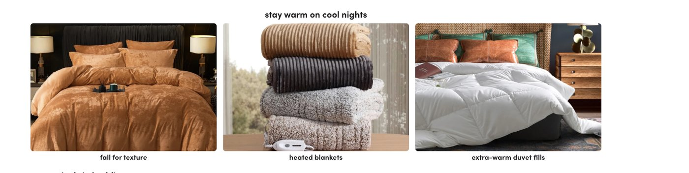

### Bedding Sets Superbrowse

Cool & Breathable exists as a filter — not a curated Smart Bedding shop.

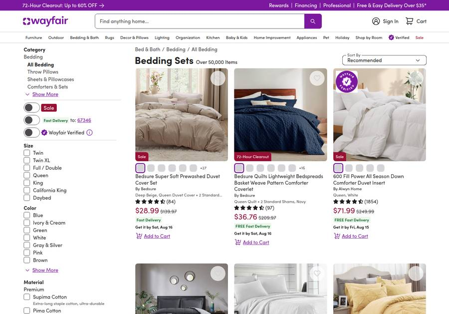

### Sheets Superbrowse

Material education started; Smart / Heated not first-class.

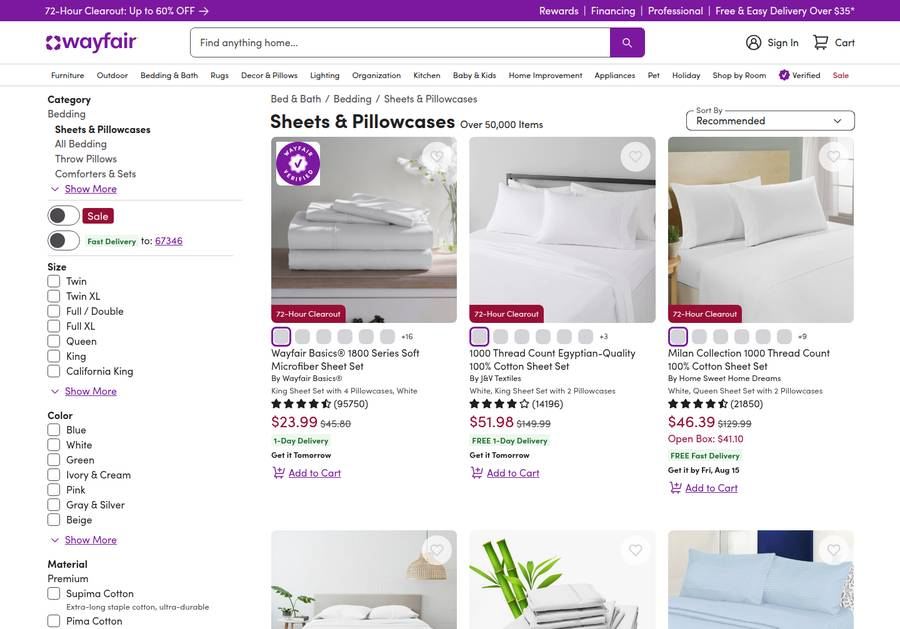

---

## Competitors

### Brooklinen — Cooling Shop

Dedicated need-based destination + benefit headline.

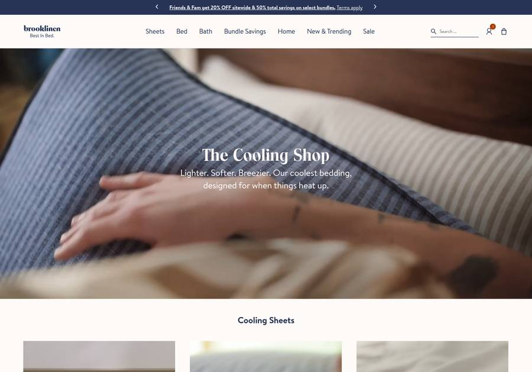

### Brooklinen — Our Bed’s Cooler

Fabric education carousel before the PLP.

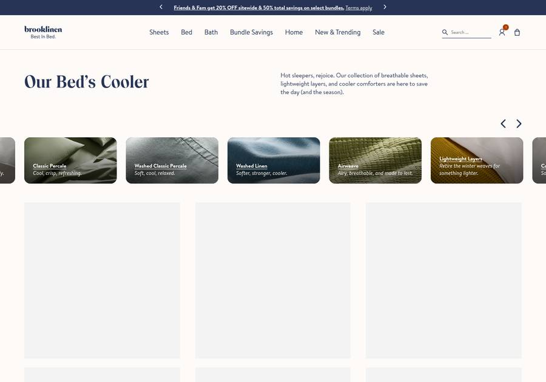

### Boll & Branch — Percale

Hot-sleeper copy + Cotton Cooling + awards.

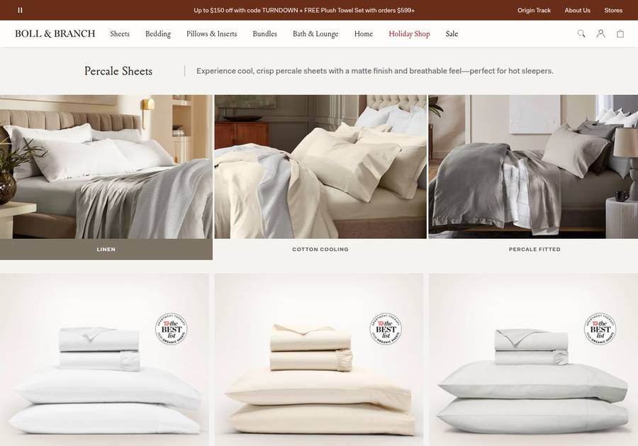

### Purple — Bedding

In-grid feature tags (moisture wicking).

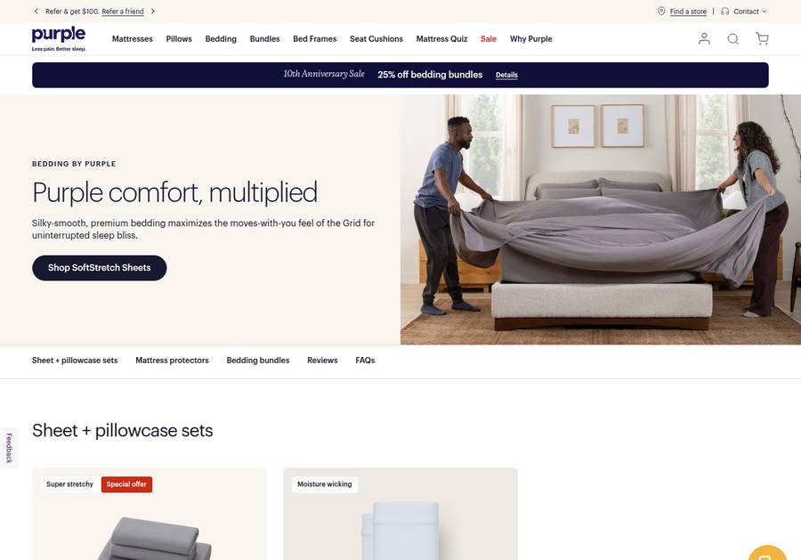

### Eight Sleep

Temperature framed as year-round sleep tech.

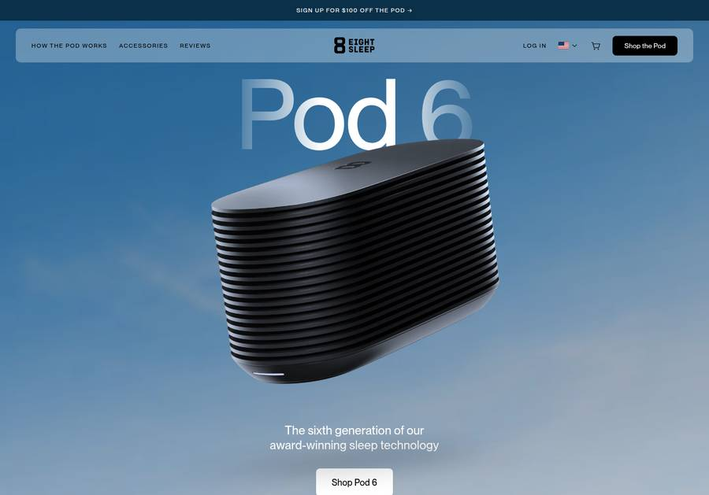

### Amazon — Cooling sheets

Attribute-rich titles + social proof density.

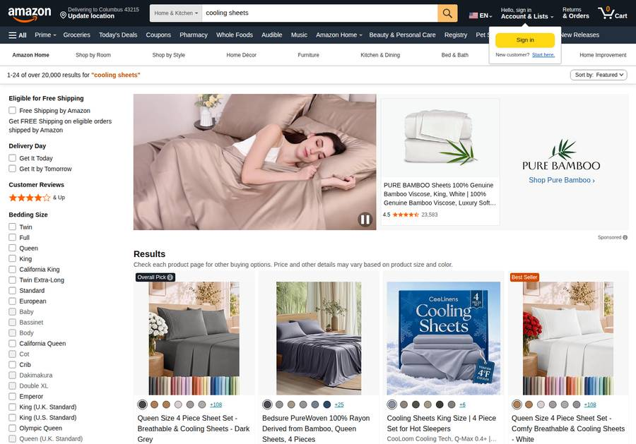

### Casper — Bedding

Editorial / category presentation for bedding.

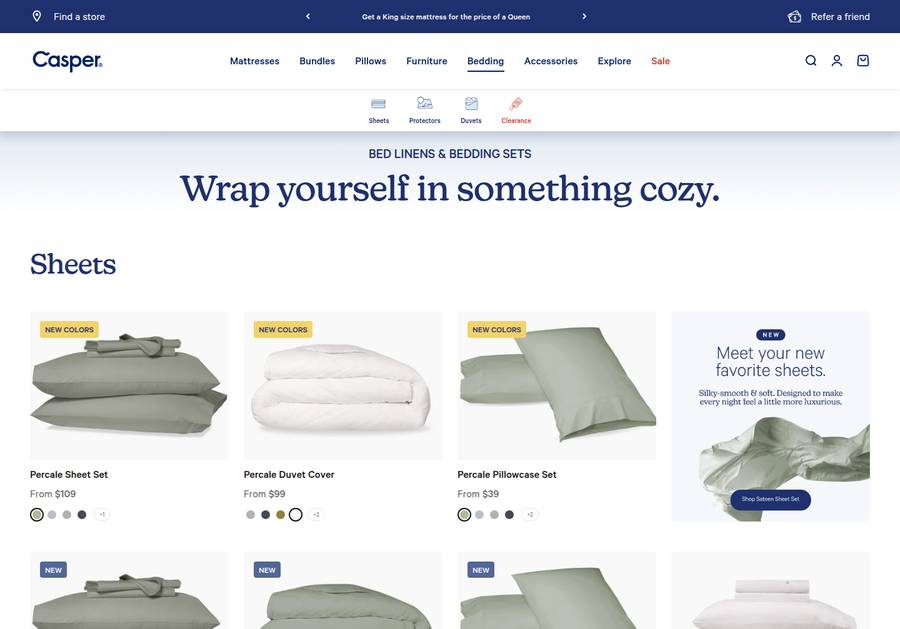

### Slumber Cloud — Cooling

Specialty cooling positioning.

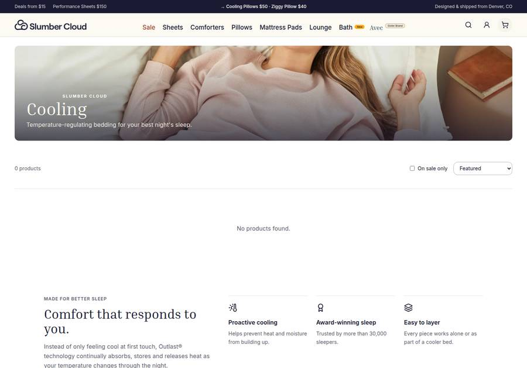

---

## Steal list

| Player | Steal this |
| --- | --- |
| Brooklinen | Cooling Shop LP + fabric/need education modules |
| Boll & Branch | Hot-sleeper category copy + award badges on PLP |
| Purple / Casper | In-grid feature tags / editorial tiles |
| Eight Sleep | Frame climate as always-on sleep wellness |
| Amazon | Performance nouns in titles + social-proof density |

## Playbook (summary)

1. **P0 — Seasonality hygiene:** Swap Cooling → Heated/Winter in flyout + ICP; Mar/Apr and Sep/Oct swap calendar with named owner (Clark/Allie).
2. **P1 — SB + search:** Standardize smart filters; UB-style feature callouts; CM search-term redirects.
3. **P1 — Sleep Climate hub:** Evergreen LP (Sleep Cooler · Sleep Warmer · Weighted · All-Season).
4. **P1–P2 — PDP conversion:** Performance naming; Waymore demos; certs/awards.
